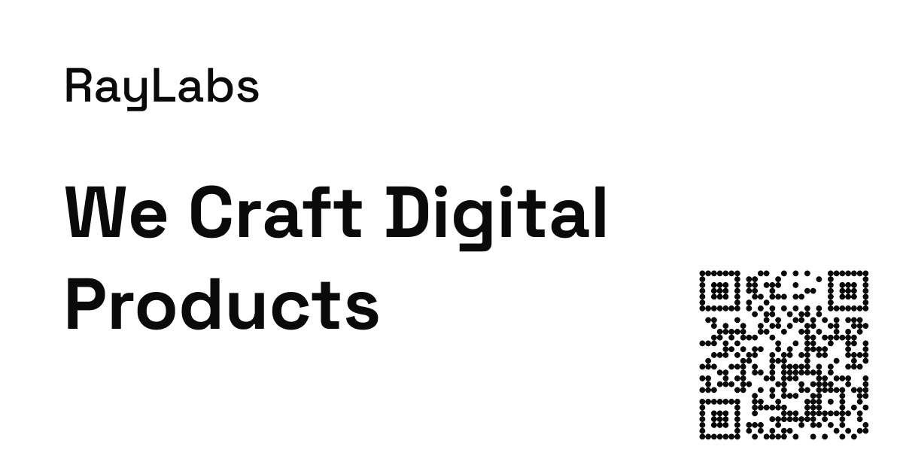
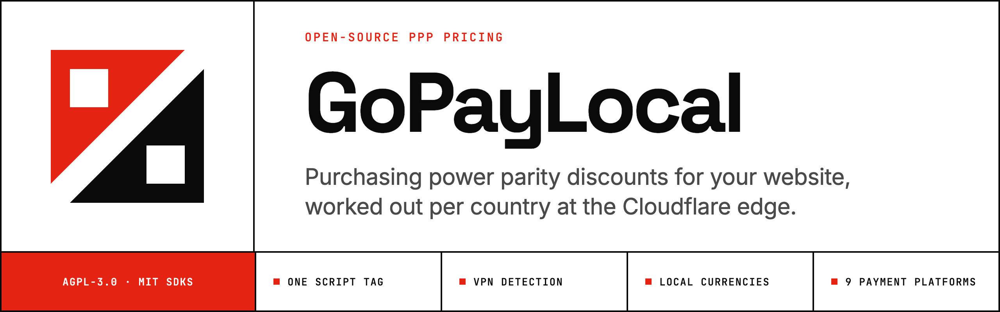
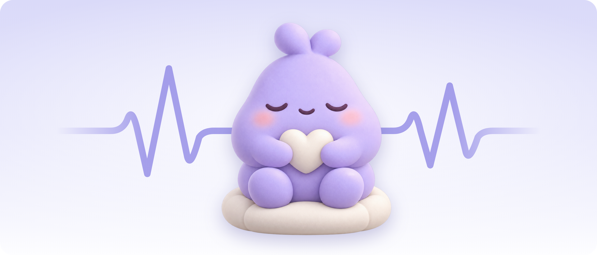
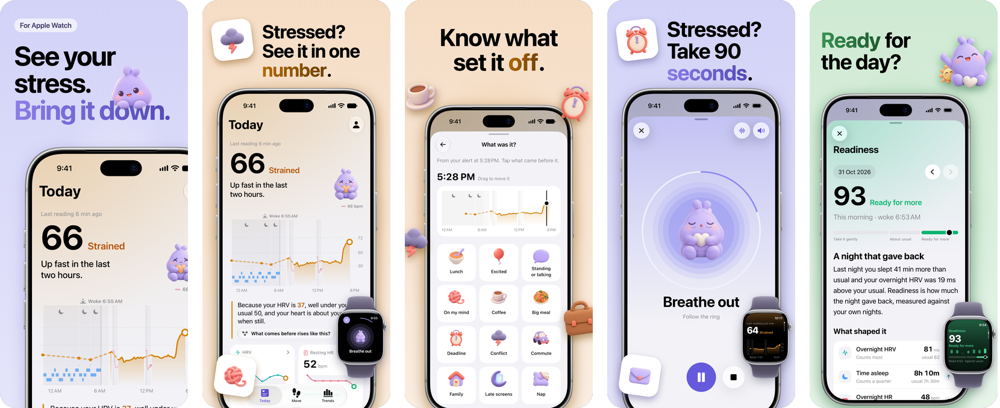
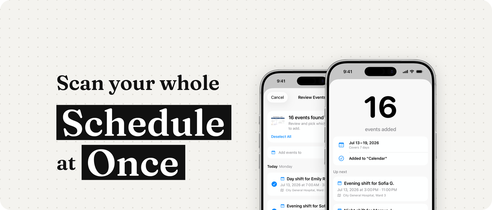
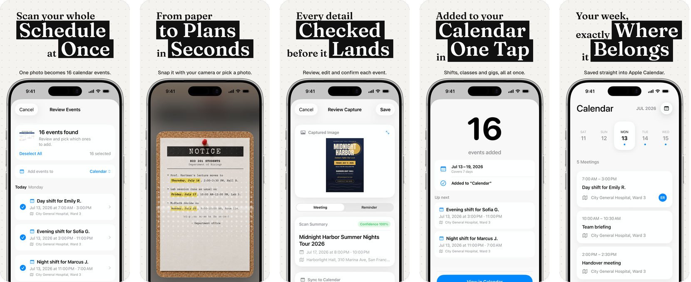
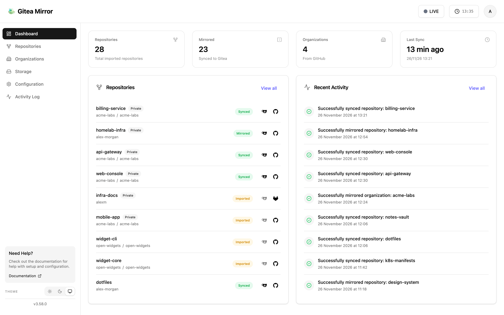

# RayLabs 🚀

<a href='https://raylabs.io'>
  <picture>
    <source srcset="./og-image-dark.png" media="(prefers-color-scheme: dark)" />
    <source srcset="./og-image-light.png" media="(prefers-color-scheme: light)" />
    
  </picture>
</a>

## Our Products

### [GoPayLocal: Open-Source PPP Pricing](https://gopaylocal.com)

**Fair prices. More customers. Zero effort.** GoPayLocal shows each visitor to your website a discount that fits their country's purchasing power, and creates the matching code in your payment platform: Stripe, Paddle, Gumroad, Chargebee, Dodo Payments, Polar, Whop, Creem or WooCommerce. One script tag, VPN detection and prices in local currencies. Use the hosted version, free to start, or run it on your own Cloudflare account.

<a href='https://gopaylocal.com'>
  <picture>
    <source srcset="./products/gopaylocal/banner-dark.png" media="(prefers-color-scheme: dark)" />
    <source srcset="./products/gopaylocal/banner-light.png" media="(prefers-color-scheme: light)" />
    
  </picture>
</a>

  

### [Yasu: Stress & HRV for Watch](https://yasu.raylabs.io)

**See your stress. Bring it down.** Yasu turns the heart readings your Apple Watch already takes into one number, measured against your own usual. When it rises, one tap says what it was. When it is high, 90 seconds of paced breathing helps bring it down. Your health data stays on your devices.

### [Lumical: Scan to Calendar](https://lumical.app)

**Scan your whole schedule at once.** Photograph a paper roster, a meeting invite, a poster or a flyer, and Lumical turns it into calendar events in seconds, with no typing. Review every event, then save them all to Apple Calendar with one tap. When the schedule changes, scan it again and only what moved is updated.

## Also from RayLabs

### [Gitea Mirror](https://github.com/RayLabsHQ/gitea-mirror)

Automatically mirror repositories from GitHub to your self-hosted Gitea instance. Features real-time syncing, organization support, and a beautiful dashboard.

<a href='https://github.com/RayLabsHQ/gitea-mirror'>
  <picture>
    <source srcset="./products/gitea-mirror/dashboard.png" media="(prefers-color-scheme: dark)" />
    <source srcset="./products/gitea-mirror/dashboard-light.png" media="(prefers-color-scheme: light)" />
    
  </picture>
</a>

## What We Do

- **Product Strategy & UX** – turning fuzzy ideas into clear roadmaps  
- **Full-Stack Development** – React / TypeScript / Next.js & friends  
- **Performance & DevOps** – speed, reliability, and sane ops from day 1  
- **In-House Experiments** – a growing suite of micro-SaaS tools

🌐 **Website** – [raylabs.io](https://raylabs.io)

📧 **E-Mail** - [hello@raylabs.io](mailto:hello@raylabs.io)

Made with care by the RayLabs crew.
